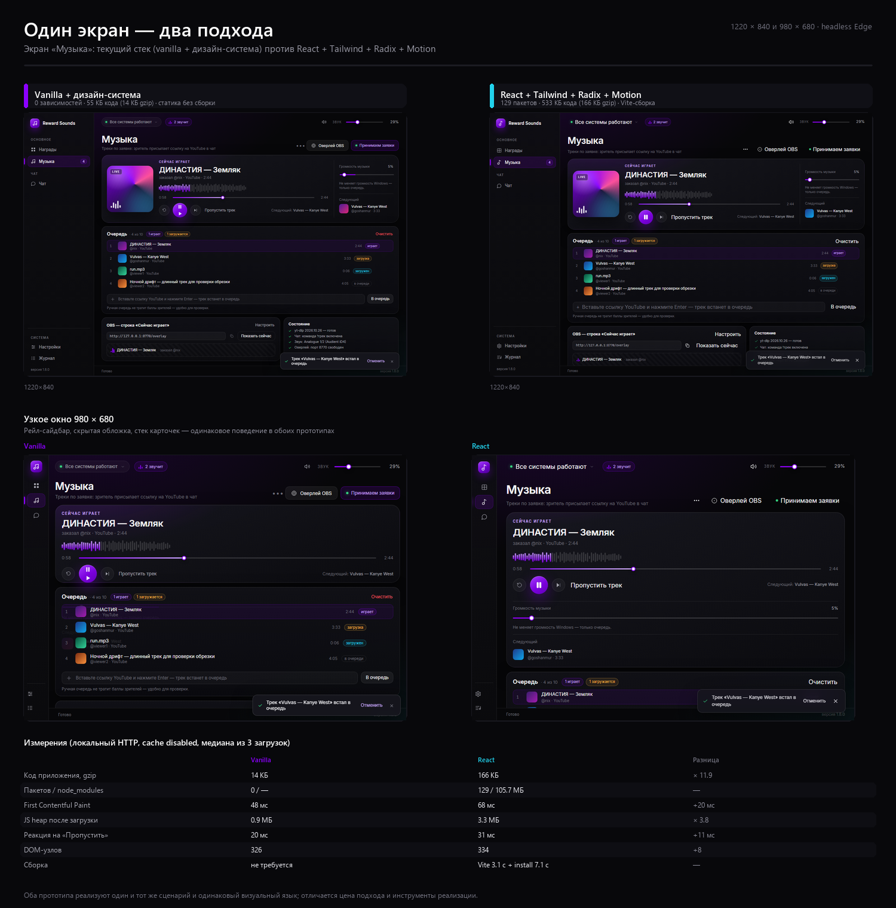

# Прототипы: «Музыка» — vanilla vs React

Два интерактивных прототипа одного экрана приложения Reward Sounds. Цель — сравнить не «красиво/некрасиво», а **цену и инструменты достижения одного и того же визуального результата**.

- Один и тот же контент, дизайн-токены и сценарии.
- Одинаковые интерактивные возможности: play/pause, перемотка, skip с отменой, удаление/перемещение трека, добавление, очистка очереди с подтверждением, громкости, тултипы, меню, тосты, клавиатура.
- Разные технологии:
  - **Vanilla** — HTML + CSS + один ES-скрипт без сборки и зависимостей.
  - **React** — Vite + React 19 + Tailwind CSS 4 + Radix UI (тултипы, меню, диалог, слайдеры) + Motion (layout-анимации).



## Как открыть

Прототипы лежат в `.design/prototypes` и **не входят в приложение** — это отдельный исследовательский артефакт.

```powershell
# из корня репозитория
cd .design\prototypes
python -m http.server 8777 --bind 127.0.0.1
```

Затем:

- Vanilla: <http://127.0.0.1:8777/vanilla/index.html>
- React (собранная версия): <http://127.0.0.1:8777/react/build/index.html>
- Со скриншотным режимом (без таймера и с готовым тостом): добавьте `?snapshot=1`.

Vanilla можно открыть и напрямую как файл (`vanilla/index.html`) — у него нет ES-модулей. React-сборка использует модульные скрипты, поэтому её нужно открывать через локальный сервер (или интегрировать в приложение).

### React: разработка и пересборка

```powershell
cd .design\prototypes\react
pnpm install
pnpm dev      # http://localhost:5173
pnpm build    # сборка в react/build
```

Сборка уже лежит в `react/build` — для просмотра достаточно сервера выше. `node_modules` в репозиторий не входит.

## Что именно сравнивается

Экран «Музыка» — самый насыщенный в приложении: сейчас играет, обложка, волна, прогресс, транспорт, громкость, очередь со статусами, OBS-оверлей, состояние подсистем и тосты. На нём хорошо видно разницу в подходах.

Оба прототипа используют:

- тёмную «студийную» тему, акцент `#8B00FF`, Inter 400/600;
- одинаковые токены цвета/радиусов/теней;
- анимированный эквалайзер, волну прогресса и «живой» прогресс;
- анимацию перестановки/удаления строк очереди;
- тосты с действием «Отменить»;
- рейл-сайдбар и перестройку карточек на 980×680.

## Измерения

Условия: локальный HTTP, `cache disabled`, headless Edge, медиана из 3 загрузок; сборка на этой машине. Цифры — ориентир для сравнения подходов, а не абсолютные бенчмарки.

| Метрика | Vanilla + дизайн-система | React + Tailwind + Radix + Motion |
|---|---|---|
| Код приложения (html+css+js) | **55 КБ**, 14 КБ gzip | **533 КБ**, 166 КБ gzip |
| Зависимости | 0 | 129 пакетов, 105.7 МБ `node_modules` |
| Сборка | не требуется (статика) | Vite 3.1 с + install 7.1 с (тёплый store) |
| First Contentful Paint | **48 мс** | 68 мс |
| JS heap после загрузки | **0.9 МБ** | 3.3 МБ |
| Реакция на «Пропустить» (2 rAF) | **20 мс** | 31 мс |
| DOM-узлов | 326 | 334 |
| LOC (весь исходник) | 1154 | 1222 |
| Шрифты | 806 КБ TTF (общие) | те же 806 КБ TTF |

Полные сырые данные: [`metrics.json`](metrics.json), [`stats.json`](stats.json). Скрипты: [`tools/measure.js`](tools/measure.js), [`tools/debug-page.js`](tools/debug-page.js).

Важно: разница в весе кода (14 → 166 КБ gzip) на локальном запуске почти не влияет на FCP, потому что основную часть загрузки в обоих случаях составляют шрифты. Но на слабых машинах и при холодном старте React добавляет парсинг ~500 КБ JS и заметно больше памяти. В настольном приложении (WebView2 уже запущен) это терпимо, но выигрыша в скорости нет.

## Совпадает ли визуал

Визуально прототипы почти идентичны: разница в нюансах анимаций и в том, насколько дёшево поддерживать систему дальше.

- **Vanilla**: все состояния и переходы описаны вручную — CSS-переменные, FLIP-анимации через Web Animations API, собственные меню/тултипы/диалог. Полный контроль и нулевые зависимости, но каждый новый компонент (меню, тултип, слайдер, фокус-ловушка) нужно поддерживать самостоятельно.
- **React + Radix**: меню, тултипы, диалог и слайдеры дают из коробки клавиатуру, фокус, порталы и ARIA. Motion даёт `layout`-анимации очереди и `AnimatePresence` для тостов без ручного FLIP. Но появляется сборка, 129 пакетов и в 3–4 раза больше памяти.

## Что выбрать

- **Только улучшить визуал текущего приложения** → не мигрировать. Вложиться в дизайн-систему, motion на CSS/WAAPI, состояния, обложки/волну, чат-эмоуты. ROI выше, риска меньше.
- **Планируется рост**: полноценный чат с эмоутами и модерацией, статистика, темы, несколько экранов и разработчиков → React + Tailwind + Radix + Motion оправдан. Переходить можно постепенно, «островами»: например, только вкладка чата или статистика, не переписывая всё сразу.
- **Хочется компонентность без веса React** → Preact/Solid/Svelte; но экосистема Radix/shadcn/Motion сильнее именно у React.

**Вывод по этому экрану:** визуальный результат достижим обоими путями; React не делает интерфейс красивее сам по себе. Для одного-двух экранов текущий vanilla дешевле и быстрее. Если приложение будет расти в сторону живого чата, статистики и дизайн-системы с переиспользуемыми компонентами — React-вариант окупается за счёт Radix/Motion и структуры.

## Ограничения прототипов

- Нет связи с реальным бэкендом Twitch/OBS/очередью — данные и анимации демонстрационные.
- Таймер воспроизведения эмулируется; прогресс и очередь живут в памяти страницы.
- Измерения сделаны в headless Edge на локальном сервере; в WebView2 приложения цифры будут отличаться.
- React-сборка не интегрирована в Tauri и не входит в дистрибутив: это сравнение подходов, а не кандидат на замену текущего UI.
