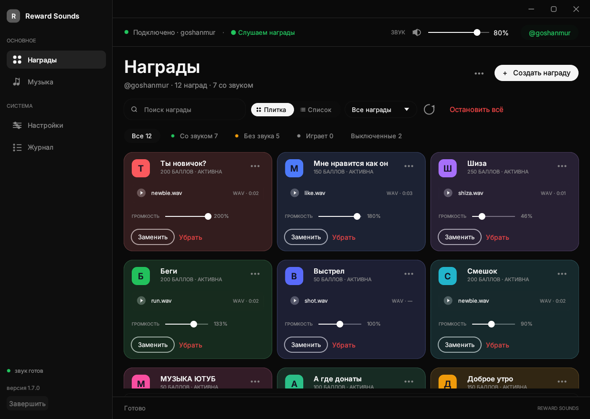
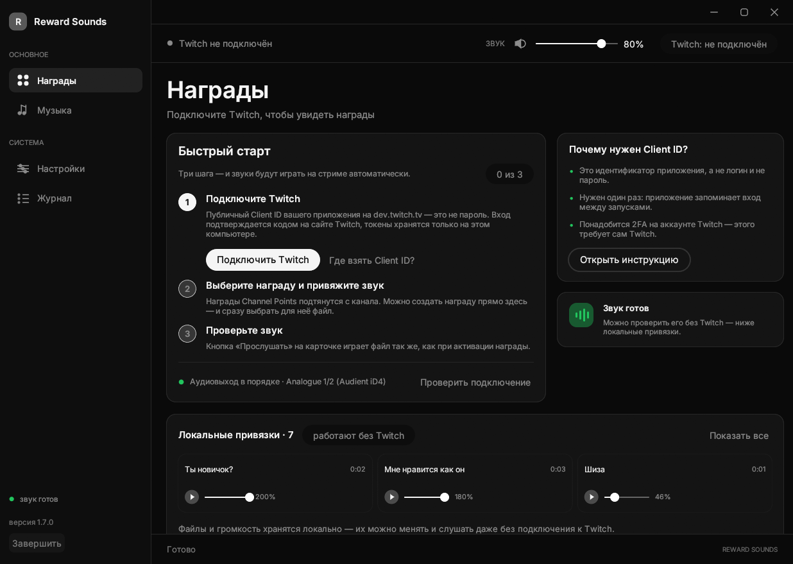
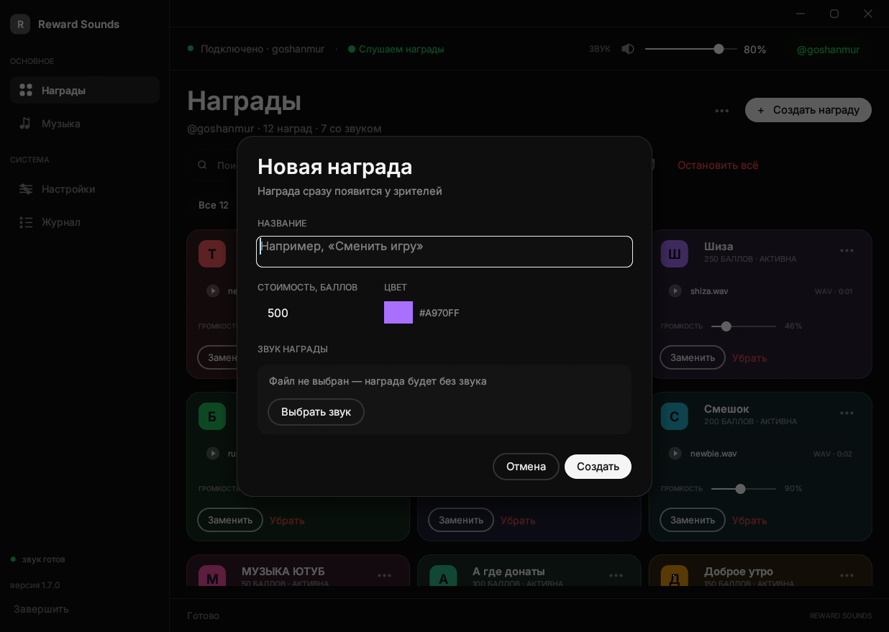
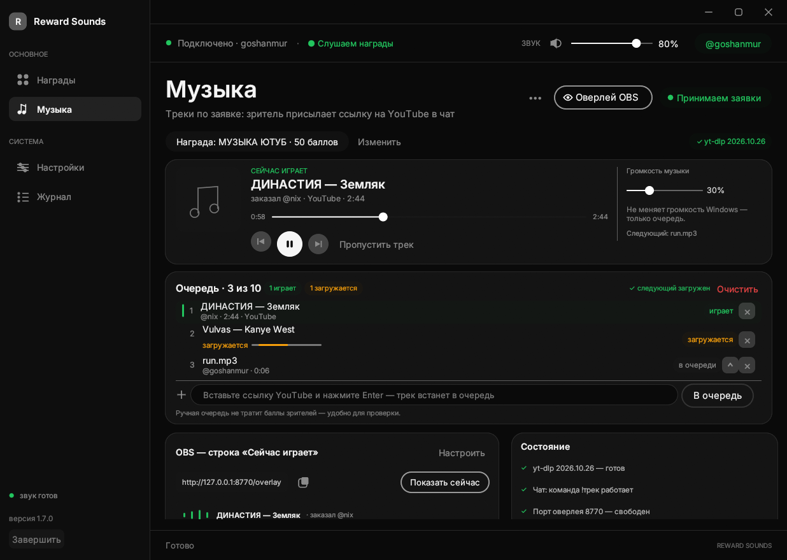
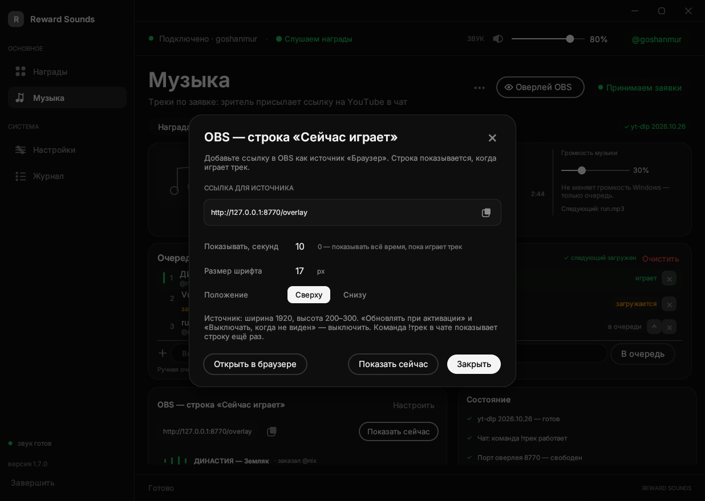
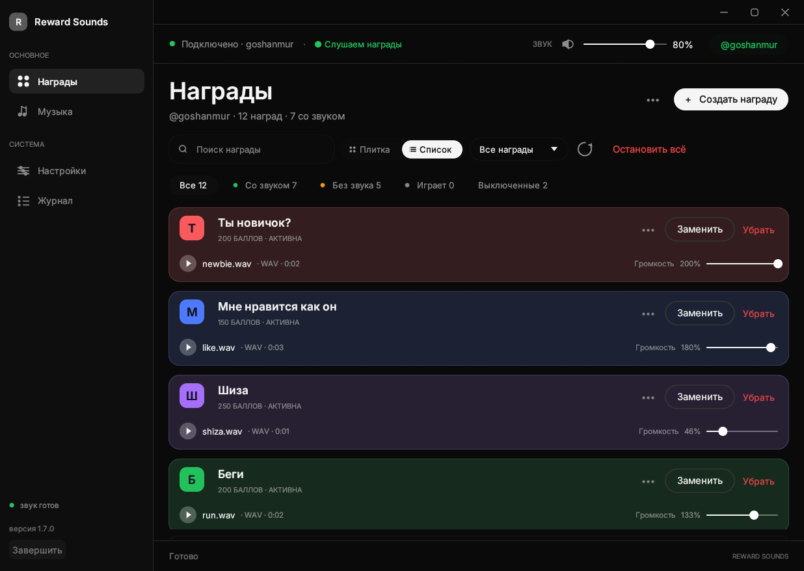

# Reward Sounds 1.7.0

**Reward Sounds** — лёгкое Windows-приложение, которое само играет ваши
локальные звуки, когда зрители активируют награды Twitch Channel Points.
Работает без Streamer.bot и Speaker.bot. Дополнительно умеет ставить треки по
заявке из чата и показывать строку «Сейчас играет» в OBS.



---

## Что нового в 1.7

- **Музыка по заявке:** зритель активирует награду и присылает ссылку на
  YouTube — трек встаёт в очередь и играет в приложении.
- **Очередь** с лимитом, длительностью, предзагрузкой, паузой, перемоткой и
  пропуском. Очередь переживает перезапуск.
- **Ручная ссылка** для проверки трека без активации награды.
- **OBS-оверлей** «Сейчас играет»: локальная страница для источника «Браузер».
- **Новый экран «Награды»:** поиск, фильтры, плитка/список, длительность файла
  прямо на карточке.
- **Глобальные статусы** подключения и прослушивания, понятные ошибки с
  кнопкой «Повторить».
- **Первый запуск** — «Быстрый старт» по шагам, локальные привязки доступны
  даже без Twitch.
- **Экономия ресурсов:** в трее приложение больше не перерисовывает интерфейс
  постоянно (CPU вместо ~4 % — меньше 0,3 % одного ядра).
- Полный список изменений — в [CHANGELOG.md](CHANGELOG.md).

## Технологии

| Задача | Решение |
|---|---|
| Язык и сборка | Rust, один EXE без рантайма |
| Шрифт | Inter (встроен, кириллица), чёткий на любом DPI |
| Интерфейс | eframe/egui 0.29, тёмная тема, системные диалоги Windows |
| Звуки наград | rodio (MP3/WAV/OGG/FLAC), отдельный аудиопоток, наложение копий |
| Музыка | yt-dlp + symphonia (AAC/MP4), свой плеер и очередь |
| Сеть (REST/WS) | reqwest (blocking) + системный TLS, tungstenite WebSocket |
| JSON | serde_json |
| Авторизация | Device Code Flow, токены в Windows DPAPI |
| Трей и автозапуск | Shell_NotifyIcon, `HKCU\...\Run` |
| Настройки | TOML + serde; очередь музыки — JSON |
| Оверлей | локальный HTTP-сервер `127.0.0.1:8770` + HTML |

Активации наград обрабатываются в фоновом потоке EventSub — звук играет
независимо от того, открыто окно или свёрнуто в трей.

---

## 1. Возможности

| Возможность | Статус |
|---|---|
| Вход в Twitch по коду, сохранение входа, обновление токена | ✅ |
| Список наград Channel Points, создание/изменение/удаление | ✅ |
| Создание награды сразу со звуком | ✅ |
| Привязка звука: выбрать / заменить / убрать / прослушать | ✅ |
| Индивидуальная громкость 0–200 %, автовыравнивание громкости | ✅ |
| Автовоспроизведение при активации (EventSub WebSocket) | ✅ |
| MP3, WAV, OGG, FLAC; наложение одновременных активаций | ✅ |
| Общая громкость, «Без звука», «Остановить всё» | ✅ |
| Трей с меню, закрытие в трей, запуск свёрнутым | ✅ |
| Автозапуск вместе с Windows | ✅ |
| Поиск, фильтры и два вида списка наград | ✅ |
| Музыка по заявке: очередь, предзагрузка, пауза, пропуск | ✅ |
| Ручная постановка трека по ссылке | ✅ |
| OBS-оверлей «Сейчас играет», команда `!трек` | ✅ |
| Сохранение очереди и восстановление после перезапуска | ✅ |
| Локальный журнал событий | ✅ |

---

## 2. Запуск

1. Распакуйте архив в любую папку, например `C:\RewardSounds`.
2. Откройте папку `dist`.
3. Дважды щёлкните **`Reward Sounds.exe`**.

Для музыки положите `yt-dlp.exe` рядом с программой (или в папку `tools`).
Без него всё остальное работает, а на вкладке «Музыка» будет подсказка, как
исправить.

Если Windows покажет «Windows защитила ваш компьютер» — нажмите
**«Подробнее» → «Выполнить в любом случае»** (стандартное предупреждение
для новых EXE без цифровой подписи).

Сборка из исходников: `cargo run --release` (нужен Rust).

---

## 3. Подключение к Twitch (один раз, ~5 минут)



Нужен **Client ID** вашего Twitch-приложения — публичный идентификатор,
не пароль. **Client Secret не используется и не хранится.**

1. Включите 2FA: `twitch.tv/settings/security`.
2. Откройте `https://dev.twitch.tv/console/apps` → **Register Your Application**.
3. Заполните:
   - **Name**: `Reward Sounds` (любое);
   - **OAuth Redirect URLs**: `http://localhost` → **Add**
     (если не принимает — `https://localhost`);
   - **Category**: `Application Integration`;
   - **Client Type**: **Public**.
4. **Create** → **Manage** → скопируйте **Client ID**.
5. В программе: «Настройки» → «Подключение к Twitch» → вставьте Client ID →
   **«Подключить Twitch»**.
6. На странице `twitch.tv/activate` введите код из окна программы →
   **Activate** → **Authorize**.

Приложение запрашивает два права:
`channel:read:redemptions` (видеть активации) и
`channel:manage:redemptions` (управлять наградами и возвращать баллы).
Пароль вводится только на сайте Twitch; токены хранятся зашифрованными
(Windows DPAPI) и только на этом компьютере.

---

## 4. Награды и звуки



На вкладке «Награды»:

- **Поиск и фильтры** — «Все», «Со звуком», «Без звука», «Играет»,
  «Выключенные». Числа на фильтрах кликабельны.
- **Плитка / Список** — переключатель в шапке; выбор запоминается.
- **«Создать награду»** — название, стоимость, цвет и сразу звук.
- **«···»** на карточке — изменить или удалить награду.
- **«Заменить» / «Убрать»** — привязка файла; звук можно прослушать кнопкой ▶.
- **Громкость** — у каждого звука свой ползунок 0–200 %; он действует и на
  активации, и на «Прослушать», и на играющий прямо сейчас звук.
- **«Остановить всё»** — в шапке и в трее.

Выключенные, приостановленные и недоступные награды свёрнуты в отдельный блок.
Привязка хранится по **ID награды**, поэтому переименование её не ломает.

Ограничения Twitch, о которых стоит знать:

- **Обложку нельзя загрузить через API** — Twitch принимает картинку только в
  панели наград. Кнопка «Панель Twitch» открывает нужную страницу.
- Цена — от 1 до 1 000 000 баллов, название — до 45 символов,
  цвет — `#RRGGBB`.

---

## 5. Музыка по заявке



1. Подключите Twitch и создайте награду с **вводом текста** (например,
   «МУЗЫКА ЮТУБ» за 50 баллов).
2. Откройте «Музыка» → «Награда и цена» → выберите награду и цену
   («Применить цену» меняет награду на Twitch).
3. Включите переключатель **«Принимать заявки»**. Статус «Принимаем заявки»
   горит зелёным только когда всё готово: Twitch подключён, активации
   слушаются, награда выбрана, yt-dlp найден.
4. Зритель активирует награду и пишет в поле ссылку на YouTube. Трек встаёт в
   очередь; ссылку можно вставить и вручную — без траты баллов.

Управление:

- **Очередь** — статусы «в очереди», «загружается», «играет», «ошибка»;
  кнопки «выше» и «убрать». «Очистить очередь» возвращает баллы зрителям.
- **Плеер** — пауза/продолжить, с начала, пропуск, перемотка по полосе,
  отдельная громкость музыки.
- **Длительность и лимит** — в «Настройках» на вкладке музыки (по умолчанию
  до 8 минут, 10 заявок).
- **Ручная очередь** — поле «Вставьте ссылку YouTube» под очередью.

Что важно знать:

- Нужен **`yt-dlp.exe`** — его не поставляем из-за частых обновлений.
  Положите файл рядом с программой или в `tools`, затем «Проверить снова».
- Аудио не сохраняется на диск: трек скачивается в память и после
  воспроизведения исчезает.
- Если очередь не помещается, новые заявки отклоняются с возвратом баллов.
- При перезапуске очередь восстанавливается (`queue.json`), играющие заявки
  возвращаются в очередь.

---

## 6. OBS-оверлей «Сейчас играет»



1. В OBS добавьте источник **«Браузер»**.
2. URL: `http://127.0.0.1:8770/overlay`
3. Ширина 1920, высота 200–300. «Обновлять при активации» и «Выключать,
   когда не виден» — выключить.
4. В приложении: «Музыка» → «Оверлей OBS» — можно скопировать ссылку,
   поменять шрифт и положение, проверить кнопкой **«Показать сейчас»**.

«Показывать, секунд» = `0` означает «всё время, пока играет трек». Команда
`!трек` в чате показывает строку ещё раз.

---

## 7. Трей и автозапуск

### Системный трей

- **Левый клик** по иконке — открыть окно.
- **Правый клик** — меню: открыть, «Воспроизводить звуки», «Остановить все
  звуки», «Выход».

Закрытие окна крестиком **сворачивает его в трей**; отключается в «Настройках».
Внизу сайдбара есть кнопка **«Завершить»** — обычный выход из приложения.

### Автозапуск и запуск свёрнутым

«Настройки» → «Запуск и системный трей»:

- **Запускать вместе с Windows** — добавляет приложение в
  `HKCU\Software\Microsoft\Windows\CurrentVersion\Run` (без прав администратора)
  с параметром `--minimized`.
- **При запуске показывать только иконку в трее** — окно не открывается.

Если проводник Windows не запущен и трей недоступен, приложение не станет
«невидимым»: через несколько секунд оно покажет окно и предупредит об этом.

---

## 8. Поиск и фильтры наград



- Поиск по названию работает вместе с активным фильтром.
- Фильтры-чипы показывают числа: сколько наград всего, со звуком, без звука,
  играет сейчас и выключено.
- «Выключенные и недоступные» — свёрнутый блок под списком.
- Ошибка загрузки списка показывается плашкой с кнопкой «Повторить».

---

## 9. Как проверить (чек-лист)

1. **Запуск:** окно открывается, «Награды» активны.
2. **Twitch:** подключён, в шапке «● Слушаем награды».
3. **Привязка:** у награды есть звук, кнопка ▶ проигрывает его.
4. **Активация:** активируйте награду на канале — звук играет за 1–2 секунды.
5. **Наложение:** активируйте 2–3 раза подряд — звуки накладываются.
6. **Громкость:** ползунок на карточке меняет громкость сразу.
7. **Трей:** закройте окно крестиком — окно исчезает, иконка остаётся;
   левый клик открывает окно, правый — меню.
8. **Автозапуск:** включите галочку и проверьте запись в `HKCU\...\Run`.
9. **Смена устройства:** переключите звук в Windows — приложение подхватит
   новое устройство автоматически.
10. **Музыка:** выберите награду и включите приём заявок, активируйте награду
    со ссылкой — трек появится в очереди и заиграет.
11. **Оверлей:** откройте `http://127.0.0.1:8770/overlay` в браузере или
    добавьте в OBS и нажмите «Показать сейчас».
12. **Перезапуск:** вход, привязки, настройки и очередь сохраняются.

---

## 10. Где хранятся настройки, очередь и журнал

```
%APPDATA%\RewardSounds\
├── config.toml                    ← громкость, Twitch, привязки, настройки трея
├── queue.json                     ← очередь музыки (если включено восстановление)
├── logs\
│   └── reward-sounds.log          ← журнал (вход, награды, звуки, ошибки)
└── tmp\                           ← временные файлы yt-dlp
```

Открыть: «Настройки» → «Данные приложения».
Не передавайте `config.toml` другим — там ваши токены (зашифрованы DPAPI).

Портативный режим:

```powershell
$env:REWARD_SOUNDS_DATA_DIR = "C:\RewardSounds\data"
.\"Reward Sounds.exe"
```

---

## 11. Устройство проекта

```
reward-sounds\
├── КАК ЗАПУСТИТЬ.txt
├── README.md
├── CHANGELOG.md
├── Cargo.toml / Cargo.lock
├── dist\Reward Sounds.exe   готовая программа
├── docs\                    скриншоты
├── src\
│   ├── main.rs              точка входа, окно, скрытый запуск
│   ├── app.rs               интерфейс: награды, музыка, настройки, журнал
│   ├── audio.rs             звук наград: микширование, громкость, смена устройства
│   ├── autostart.rs         автозапуск (реестр HKCU)
│   ├── config.rs            настройки TOML и привязки к наградам
│   ├── eventsub.rs          WebSocket EventSub, переподключение, дедупликация
│   ├── http.rs              HTTP (reqwest) и WebSocket (tungstenite)
│   ├── json.rs              JSON через serde_json
│   ├── logging.rs           журнал
│   ├── playback.rs          фоновое проигрывание наград (EventSub)
│   ├── tray.rs              системный трей (Shell_NotifyIcon + меню)
│   ├── twitch.rs            вход, токены, профиль, список наград
│   ├── secure_store.rs      шифрование токенов (DPAPI)
│   ├── theme.rs / icon.rs   оформление и иконка
│   ├── music\               музыка по заявке и OBS-оверлей
│   │   ├── service.rs       заявка → проверка → очередь → плеер
│   │   ├── queue.rs         очередь и её JSON-хранилище
│   │   ├── player.rs        воспроизведение, пауза, перемотка
│   │   ├── ytdlp.rs         yt-dlp: метаданные и аудио
│   │   ├── decode.rs        декодер AAC/fMP4 поверх symphonia
│   │   ├── prefetch.rs      предзагрузка следующего трека
│   │   ├── links.rs         разбор ссылок YouTube
│   │   ├── chat.rs          команда !трек в чате
│   │   ├── overlay.rs       HTTP-сервер оверлея
│   │   └── yandex.rs        пауза Яндекс Музыки через SMTC
│   └── util.rs              мелкие помощники
├── assets\
│   └── overlay.html         страница оверлея для OBS
├── examples\
│   └── net_probe.rs         проверка сети: HTTPS + WebSocket Twitch
└── tests\
    └── audio_smoke.rs       проверка реального звука и фонового запуска
```

---

## 12. Если что-то пошло не так

| Симптом | Что делать |
|---|---|
| Иконки нет в трее | Проверьте, что проводник Windows запущен. В настройках видно «трей доступен/недоступен». |
| Окно закрывается, а не сворачивается | Проверьте переключатель «Закрывать окно в трей». |
| «Награды не слушаются» | «Настройки» → «Переподключить события» или перезапуск. |
| Награда активирована, звука нет | Проверьте привязку и наличие файла; журнал подскажет причину. |
| Twitch не дал право управлять наградами | Переподключите аккаунт: «Настройки» → «Отключить Twitch» → «Подключить Twitch». |
| «Наград не найдено» | Создайте награды в панели «Награды за баллы» и обновите список. |
| Автозапуск не работает | Проверьте `HKCU\Software\Microsoft\Windows\CurrentVersion\Run`, значение `RewardSounds`; антивирус может блокировать запись. |
| Нет звука | Громкость приложения, «Без звука», громкость Windows, выбранное устройство. |
| Музыка не принимает заявки | Смотрите чек-лист на вкладке «Музыка»: Twitch, прослушивание, награда, yt-dlp. |
| «Нет yt-dlp» | Положите `yt-dlp.exe` рядом с программой или в `tools`, нажмите «Проверить снова». |
| Очередь не восстановилась | Проверьте «Сохранять очередь» и `%APPDATA%\RewardSounds\queue.json`. |
| Оверлей пустой | Приложение запущено, музыка играет или нажата «Показать сейчас»; URL `127.0.0.1:8770/overlay`. |
| SmartScreen при запуске | «Подробнее» → «Выполнить в любом случае». |

---

## 13. Приватность и безопасность

- Пароль Twitch вводится только на сайте Twitch. Client Secret приложению не
  нужен и не хранится.
- Access/refresh токены хранятся в `config.toml` зашифрованными через Windows
  DPAPI и привязаны к учётной записи Windows.
- Локальные звуки никуда не загружаются. Музыка скачивается с YouTube через
  `yt-dlp` по ссылке зрителя.
- Оверлей — локальная страница на `127.0.0.1:8770`; извне она недоступна.
- Журнал не содержит токенов; файлы `config.toml` и `queue.json` не стоит
  передавать другим.

---

## 14. Итог

Приложение закрывает ежедневные задачи стримера: вход в Twitch, награды,
звуки с индивидуальной громкостью, трей и автозапуск, музыка по заявке и
OBS-оверлей. Сторонние программы нужны только для музыки (`yt-dlp.exe`).
